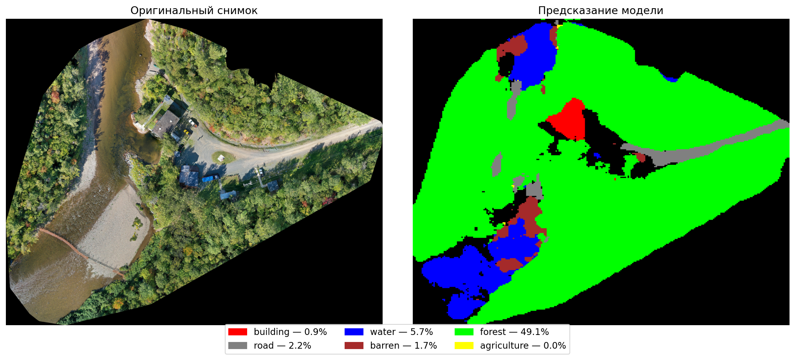

# Satellite Image Semantic Segmentation

**Course Project**

A project on semantic segmentation of satellite imagery for land cover classification using **U-Net** with a pretrained **EfficientNet-B3** encoder.

The project explores and compares two segmentation models trained on different remote sensing datasets: DeepGlobe and LoveDA.

## Results

| Metric | Model 1 | Model 2 |
|---|---:|---:|
| Dataset | DeepGlobe | LoveDA |
| Number of Images | 803 | 2,522 (rural + urban) |
| Mask Format | RGB | Grayscale |
| Test mIoU | **0.5459** | **0.6417** |

### Per-Class IoU

| **Model 1 — DeepGlobe** | **IoU** | **Model 2 — LoveDA** | **IoU** |
|---|---:|---|---:|
| Urban | 0.73 | Building | 0.40 |
| Agriculture | 0.84 | Road | 0.73 |
| Rangeland | 0.36 | Water | 0.70 |
| Forest | 0.71 | Barren Land | 0.80 |
| Water | 0.69 | Forest | 0.63 |
| Barren Land | 0.49 | Agriculture | 0.79 |


### Qualitative Results

#### Semantic Segmentation of External Aerial Imagery

To demonstrate the model's ability to process aerial imagery
from different sources, an additional inference experiment
was performed using an image from OpenAerialMap.


Image © G Dixon, Jacquet River Salmon Barrier, via OpenAerialMap, licensed under CC BY 4.0. Image processed for semantic segmentation; prediction generated by this project.

The visualization shows the original aerial image alongside
the semantic segmentation predicted by the LoveDA model.

**Predicted classes:**
- Building
- Road
- Water
- Barren
- Forest
- Agriculture

*Note: This is a qualitative inference example.
Ground-truth annotations are not available for this image.*

**Image Attribution:**
- Title: Jacquet River Salmon Barrier
- Contributor: G Dixon
- Source: [OpenAerialMap](https://imagery.hotosm.org/browse?lat=47.8992&lon=-66.0243&zoom=17.7&license=CC-BY+4.0&selected_id=5da4c6e2cac1190007698b11)
- License: [CC BY 4.0](https://creativecommons.org/licenses/by/4.0/)
- Modifications: The original image was processed for
  semantic segmentation. The prediction mask and visualization
  were generated by this project.

## Technologies

- **Python** — programming language
- **PyTorch** — deep learning framework
- **segmentation-models-pytorch** — segmentation model implementation
- **Albumentations** — image augmentation
- **torchmetrics** — model evaluation

### Model Architecture

- Architecture: U-Net
- Encoder: EfficientNet-B3 (pretrained on ImageNet)
- Input resolution: 256 × 256
- Loss function: Dice Loss + Soft Cross-Entropy
- Optimizer: AdamW
- Training: 50 epochs

## Installation

Clone the repository and install the required dependencies:

```bash
git clone https://github.com/NoNikky/satellite-segmentation.git
cd satellite-segmentation
pip install -r requirements.txt
```

## Usage

1. Download the pretrained model weights from the [Releases](../../releases) section.
2. Place the downloaded weights in the same directory as the prediction scripts.
3. Put satellite images into the `input/` directory.
4. Run one of the prediction scripts:

```bash
# LoveDA model
python predict_model2.py

# DeepGlobe model
python predict_model1.py
```

The segmentation results will be saved in the `output/` directory.

## Training

To train the models, run the following commands:

**Model 1 — DeepGlobe:**

```bash
python cache_masks.py
python train_model1.py
```

**Model 2 — LoveDA:**

```bash
python train_model2.py
```

Dataset paths and training configuration are specified at the beginning of the corresponding scripts.

## Datasets

This project uses two publicly available remote sensing datasets for semantic segmentation:

- **[DeepGlobe Land Cover Classification Dataset](https://www.kaggle.com/datasets/balraj98/deepglobe-land-cover-classification-dataset)** — a satellite imagery dataset designed for land cover classification and semantic segmentation.

- **[LoveDA Dataset](https://doi.org/10.5281/zenodo.5706578)** — a high-resolution remote sensing dataset for land cover semantic segmentation and domain adaptation, containing both urban and rural satellite images.

### Dataset References

- DeepGlobe: [Kaggle Dataset](https://www.kaggle.com/datasets/balraj98/deepglobe-land-cover-classification-dataset)
- LoveDA: [Official Dataset (Zenodo)](https://doi.org/10.5281/zenodo.5706578) | [GitHub Repository](https://github.com/Junjue-Wang/LoveDA)

## Project Information

This repository contains the implementation and experimental results of a **course project** focused on deep learning methods for semantic segmentation of satellite imagery.

The project demonstrates the application of convolutional neural networks to remote sensing image analysis and compares segmentation performance across two different datasets.
Pretrained model weights are not included in this repository. To reproduce the results, train the models using the provided training scripts and the original datasets.
